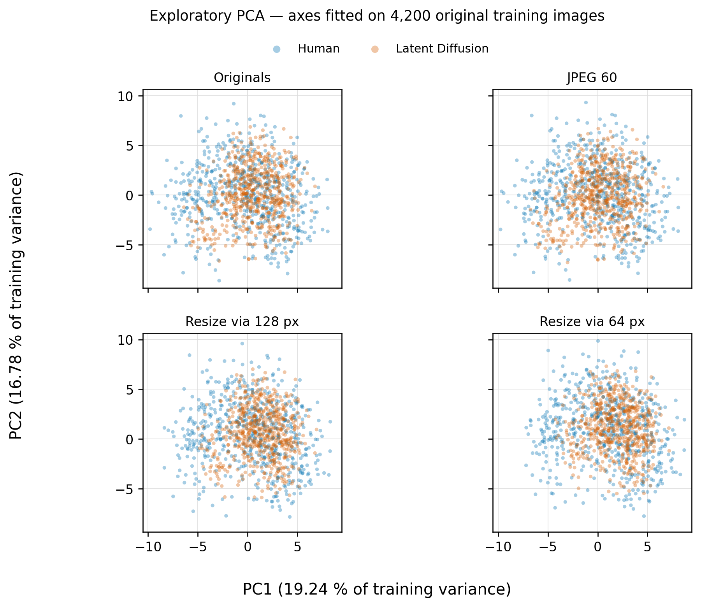

# Exploratory PCA of 55 features and transformation sensitivity

## Aim and status

Describe changes in 55 visual features after JPEG compression/resizing and compare paired displacements for Human and Latent Diffusion (LD). This is separate from the main pipeline, without detector retraining, threshold changes or causal error analysis.



## Reproduction

From the root with `.venv_repro`:

```bash
OMP_NUM_THREADS=4 OPENBLAS_NUM_THREADS=4 PYTHONHASHSEED=0 MPLBACKEND=Agg ./.venv_repro/bin/python -m analysis.pca_features
```

To recreate only the figure from exported coordinates/variance, without raw data or models:

```bash
MPLBACKEND=Agg ./.venv_repro/bin/python -m analysis.pca_features --figure-only
```

Commands actually ran in isolated `local/pca-features-2026-11-15/evaluation/`, with Python 3.9.6, NumPy 2.0.2, scikit-learn 1.6.1 and Pillow 11.3.0. Matplotlib/Python caches were redirected there. The full process took 48.46 s (33.13 s after imports). `--figure-only` ran twice with raw inputs, models and train/test features unavailable; PNG/PDF bytes matched between runs.

## Data, columns and fitting

The 55 columns come from `feature_names` in saved `models/logistic_full.joblib`, checked against the schema/order of `analysis.image_features.extract_features`:

- 48 color histogram features: `color_{red,green,blue}_{00..15}`, 16 bins per channel in [0, 256). Each feature is a pixel proportion, not a channel mean.
- Four grayscale absolute-difference statistics: `edge_horizontal_mean`, `edge_horizontal_std`, `edge_vertical_mean`, `edge_vertical_std`.
- Three FFT-energy shares after grayscale mean removal: `freq_low` (radius < 0.10), `freq_mid` (0.10 ≤ radius < 0.25), `freq_high` (radius ≥ 0.25).

Full names/order are in `results/pca_scaling.csv` and JSON metadata. Original train features are reused from `results/train_validation_features.csv`: only **4 200 training-split rows**, ID-aligned to the manifest (2 100 Human and 2 100 LD), enter fitting. The 600 validation rows are excluded.

Existing CSVs did not store the 55 test features per condition; historical predictions contain scores/decisions only. Features of **1 200 test images** were therefore recomputed for seven conditions with `make_variants` and `extract_features`, without redefining transformations: original, JPEG 85/60/35 at 4:2:0, 128/64 px downscaling then LANCZOS restoration to 256 × 256, and 128 px then JPEG 60. They are now in `pca_test_features.csv` (8 400 rows).

1. Fit `StandardScaler` on 4 200 original train images: centering and population standard deviation (`ddof=0`). Means, variances and scales **exactly** reproduce the full logistic model's saved scaler. No variance is zero.
2. Fit `PCA(svd_solver="full", whiten=False)` on this standardized train, without class labels. Compute all 55 components for the complete spectrum; display only PC1/PC2.
3. Apply identical means, scales, PCA center and axes to 8 400 test rows. No class-/condition-specific fit, and no fitting on test or validation.
4. Check columns, 1 200 unique IDs per condition and class/style metadata. Each class has 600 images; train/test are disjoint.

## Variance and axis contributions

PC1 explains **19.24%**, PC2 **16.78%**, totaling **36.02%** of standardized training variance. The remaining **63.98%** is not shown; 15 components reach 80% and 25 reach 90%. The plane therefore shows a limited share of the 55-feature structure.

An “axis contribution” here is **100 × squared eigenvector coefficient**, for an eigenvector of norm 1: 55 contributions sum to 100% per axis. Signed coefficients are exported separately. These are neither logistic coefficients nor contributions to detection errors.

| Axis | Variable | Signed coefficient | Contribution (%) |
|---|---|---:|---:|
| PC1 | `color_green_03` | +0.21965 | 4.82 |
| PC1 | `color_red_04` | +0.20977 | 4.40 |
| PC1 | `color_blue_02` | +0.19936 | 3.97 |
| PC1 | `color_red_03` | +0.19649 | 3.86 |
| PC1 | `color_green_04` | +0.19328 | 3.74 |
| PC2 | `color_green_07` | +0.24656 | 6.08 |
| PC2 | `color_green_08` | +0.23861 | 5.69 |
| PC2 | `color_red_08` | +0.22612 | 5.11 |
| PC2 | `color_green_06` | +0.22423 | 5.03 |
| PC2 | `color_red_09` | +0.22081 | 4.88 |

Color features account for **87.35% of PC1 contributions** and **95.97% of PC2**. This describes variation between original training images, not which features change most under transformations. The 48 color features are numerous/correlated, with histogram shares summing to 1 per channel. Frequency shares also sum to 1. The 55 standardized features are not independent. PCA signs are arbitrary: reversing an axis reverses coordinates/signed shifts, not distances.

## Paired displacements, seven conditions

For each ID compute **ΔPC = PC(variant) − PC(original)**, then its Euclidean norm in the plane. The table shows the **median of individual distances**, not centroid distance or the norm of a median. CSVs also contain individual signed shifts, signed means/medians, quartiles and distances in the full standardized 55-feature space.

| Condition | Class | Mean ΔPC1 | Mean ΔPC2 | Median PC1–PC2 distance | Median distance in 55 features |
|---|---|---:|---:|---:|---:|
| Originals | Human | +0.0000 | +0.0000 | 0.0000 | 0.0000 |
| Originals | Latent Diffusion | +0.0000 | +0.0000 | 0.0000 | 0.0000 |
| JPEG 85 | Human | +0.0022 | +0.0210 | 0.0308 | 0.1935 |
| JPEG 85 | Latent Diffusion | -0.0729 | -0.0219 | 0.0710 | 0.2462 |
| JPEG 60 | Human | +0.0353 | +0.0605 | 0.0791 | 0.3896 |
| JPEG 60 | Latent Diffusion | -0.3010 | -0.1538 | 0.2958 | 0.8857 |
| JPEG 35 | Human | +0.1047 | +0.1206 | 0.1577 | 0.6241 |
| JPEG 35 | Latent Diffusion | +0.1740 | +0.1568 | 0.2036 | 0.5406 |
| 128 px | Human | +0.5641 | +0.4429 | 0.5921 | 1.4410 |
| 128 px | Latent Diffusion | +0.7232 | +0.5289 | 0.6796 | 1.6662 |
| 64 px | Human | +1.1004 | +0.8960 | 1.2431 | 2.8092 |
| 64 px | Latent Diffusion | +1.3449 | +1.0403 | 1.3989 | 3.1701 |
| 128 px then JPEG 60 | Human | +0.5410 | +0.4568 | 0.5793 | 1.4574 |
| 128 px then JPEG 60 | Latent Diffusion | +0.7050 | +0.5433 | 0.6766 | 1.6344 |

All four panels share limits and scale, without removing outliers: 600 blue Human and 600 orange LD points per panel. Axes and percentages come from training data, including for original test images.

## Feature sensitivity versus PCA contributions

For feature j, class and condition, compute **medianᵢ |(xᵢ,variant,j − xᵢ,original,j) / stdⱼ,train|**. This uses the 55 original standardized dimensions, independently of PCA. Absolute values are taken **before** the median to avoid cancellation. Signed median changes are also exported to describe direction, as a different statistic. Descending ranks are specific to class/condition, ties broken by column order. Original-image changes are exactly zero, so their ranks are uninformative.

Most sensitive features for the three transformed conditions in the figure (top three per group; units = training standard deviations):

| Condition | Class | Variable | Absolute median Δz | Signed median Δz |
|---|---|---|---:|---:|
| JPEG 60 | Human | `edge_vertical_mean` | 0.0815 | -0.0568 |
| JPEG 60 | Human | `edge_horizontal_mean` | 0.0699 | -0.0488 |
| JPEG 60 | Human | `edge_vertical_std` | 0.0622 | -0.0622 |
| JPEG 60 | Latent Diffusion | `edge_vertical_mean` | 0.4043 | +0.4043 |
| JPEG 60 | Latent Diffusion | `edge_horizontal_mean` | 0.3909 | +0.3909 |
| JPEG 60 | Latent Diffusion | `freq_high` | 0.3569 | +0.3569 |
| 128 px | Human | `freq_high` | 0.6507 | -0.6507 |
| 128 px | Human | `edge_vertical_std` | 0.5876 | -0.5876 |
| 128 px | Human | `edge_vertical_mean` | 0.5412 | -0.5412 |
| 128 px | Latent Diffusion | `freq_high` | 0.6970 | -0.6970 |
| 128 px | Latent Diffusion | `edge_horizontal_std` | 0.6838 | -0.6838 |
| 128 px | Latent Diffusion | `edge_vertical_std` | 0.6311 | -0.6311 |
| 64 px | Human | `edge_vertical_std` | 1.0809 | -1.0809 |
| 64 px | Human | `freq_mid` | 1.0378 | -1.0378 |
| 64 px | Human | `edge_horizontal_std` | 0.9958 | -0.9958 |
| 64 px | Latent Diffusion | `edge_horizontal_std` | 1.2169 | -1.2169 |
| 64 px | Latent Diffusion | `edge_vertical_std` | 1.1378 | -1.1378 |
| 64 px | Latent Diffusion | `edge_horizontal_mean` | 1.1177 | -1.1177 |

The sensitivity CSV has **770 rows**: 55 features × seven conditions × two classes, including JPEG 85/35 and the combined condition, although the figure has only four conditions.

## Interpretation and short conclusion

Resizing produces larger median PC1–PC2 distances than JPEG 60: **Human/LD = 0.079/0.296** for JPEG 60, **0.592/0.680** for 128 px, **1.243/1.399** for 64 px. Both classes move in the same mean PC1/PC2 directions after resizing, with larger median LD distances. At JPEG 60, mean shifts have opposite class signs on both axes: Human (+0.035; +0.060), LD (−0.301; −0.154).

Most sensitive features are primarily edges and frequencies, despite color-dominated axes. At 128 px, `freq_high` has the largest median absolute change for Human (**0.651 standard deviation**) and LD (**0.697**), both downward. At 64 px, the top features are `edge_vertical_std` for Human (**1.081**) and `edge_horizontal_std` for LD (**1.217**), also downward. Features can change substantially while contributing less to the displayed axes.

JPEG does not always shift both classes in the same direction: at JPEG 60, the signed median of `edge_vertical_mean` is **−0.057** for Human and **+0.404** for LD (absolute medians 0.081 and 0.404). LD distances are not monotonic with JPEG quality: 0.071 at 85, 0.296 at 60, 0.204 at 35 in the plane. This describes these features/images without establishing causality; original JPEG traces and recompression may contribute.

**Conclusion for the report:** resizing primarily changes edges/frequency energy among the existing 55 features, with larger PCA displacements than the studied JPEG conditions. Human/LD shifts differ, sometimes even in direction at JPEG 60. Color-dominated PC1/PC2 explain only 36.02% of training variance: apparent visual stability does not imply stability of all 55 features. Exploratory PCA does not establish which features cause detector errors.

## Files and checks

- [`analysis/pca_features.py`](../analysis/pca_features.py): separate command, not added to `run_all.py`.
- [`pca_test_features.csv`](../results/pca_test_features.csv): 8 400 rows of 55 unstandardized features for seven conditions.
- [`pca_test_coordinates.csv`](../results/pca_test_coordinates.csv): 8 400 original/transformed coordinates, ΔPC1/ΔPC2 and paired norms.
- [`pca_displacement_summary.csv`](../results/pca_displacement_summary.csv): 14 class × condition summaries.
- [`pca_feature_sensitivity.csv`](../results/pca_feature_sensitivity.csv): 770 absolute/signed medians and feature ranks.
- [`pca_scaling.csv`](../results/pca_scaling.csv): 55 names, training means/variances/scales and standardized PCA center.
- [`pca_explained_variance.csv`](../results/pca_explained_variance.csv): 55 components and cumulative variance.
- [`pca_axis_contributions.csv`](../results/pca_axis_contributions.csv): 110 PC1/PC2 coefficients and contributions.
- [`pca_feature_transformations.png`](../figures/pca_feature_transformations.png) and [PDF](../figures/pca_feature_transformations.pdf): compact shared-axis figure.
- [`PCA_FEATURES.json`](PCA_FEATURES.json): parameters, columns, hashes, environment, timing and audit.

Checks actually performed:

- Independently recompute scaling from only 4 200 training rows; exact match to historical scaler.
- Independently eigendecompose training covariance with `numpy.linalg.eigh`, separate from sklearn SVD: eigenvalues, variance ratios and two eigenvectors agree to 10⁻¹² after sign alignment. Contributions sum to 100% per axis.
- Manually recompute projections, paired displacements, summaries and 770 median absolute changes; agreement to 10⁻¹².
- Re-extract **8 400 test rows from raw images**: exact match to saved CSV; 20 re-extracted train originals also match reused values. Not all 4 200 train originals were re-extracted.
- Check seven-condition pairing, classes, columns and counts; reference displacements are zero.
- `--figure-only` works without raw data, model or input features; two byte-identical PNG/PDF regenerations and visual inspection.
- Python 3.9 syntax and `git diff --check` verified. **120 protected preexisting files** retain SHA-256: models, main results, augmentation, JPEG intervention, figures and documents.
- Manifest unchanged: `e04565ff1a9b44a817501680db0dafb316d58e122429bac526b414e5b205a606`. Copies, logs and audits in Git-ignored `local/pca-features-2026-11-15/`.

No hypothesis test, retrained detector or attribution of false positives/decisions to a feature. Same images and one split, retaining original JPEG traces. No new independent collection or causal validation. No commit or push.